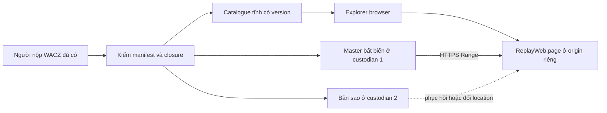
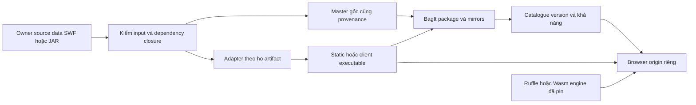
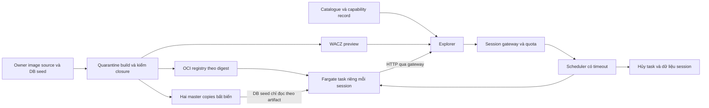

# Stage 1 — Agent C: Technical Research & Architecture

## Metadata

| Mục | Giá trị |
|---|---|
| Run / phạm vi | `2026-11-26-mission-heritage-resurrection`, Stage 1; chỉ kiến trúc và bằng chứng kỹ thuật |
| Model / effort quan sát được | `gpt-6.1-sol` / `high`: tiến trình cha `codex` có `-m gpt-6.1-sol` và `model_reasoning_effort=high`; không xác minh được model ở từng request phía dịch vụ |
| Bắt đầu UTC | `2026-11-26T02:39:01Z` — mốc đồng hồ đầu tiên ghi được |
| Kết thúc UTC | `2026-11-26T02:57:07Z` |
| Tìm kiếm | Khoảng 18 truy vấn web có mục tiêu; không khởi động lại discovery rộng |
| References dùng trong báo cáo | `41` mở trực tiếp đọc được nội dung; `0` chỉ snippet; 1 seed không truy cập được, không tính vào hai số trên |
| Claim duy nhất | `VERIFIED 23; INFERENCE 16; HYPOTHESIS 10; UNKNOWN 3; tổng 52` |
| Thất bại / giới hạn | Trang chủ và FAQ Software Heritage lỗi TLS/timeout; tài liệu SWH bị Anubis chặn. LoC “For Researchers” HTTP 403; một URL PhET cũ 404, đã mở URL gốc hoạt động. EaaSI GitLab chuyển sang đăng nhập/403; hai đường dẫn handbook đoán theo cấu trúc cũ 404, dùng FAQ phiên bản 2021-10 đọc được. OCI website và repo2docker chỉ trả vỏ/redirect, không xem đó là đọc được spec; OCI được thay bằng source spec chính thức, version-pinned. Chi tiết cuối §1 và References. |
| Không thực hiện | Không capture, crawl, chạy emulator, phần mềm lịch sử, container hay mã cộng đồng; không benchmark, phỏng vấn, cài gói, commit, sửa progress hay đọc agent khác trong run hiện tại |
| Quan sát vận hành | Phiên unsandboxed, ranh giới thư mục tự tuân thủ; không có đo token cached/uncached hay chi phí phiên nghiên cứu. Không suy ra hiệu quả chuyên môn hóa từ riêng báo cáo này. |

## 1. Method

Đi từ công nghệ và cơ chế đang có tới lớp chức năng thực sự giữ được, rồi mới xét kiến trúc. Báo cáo này cung cấp ba **phương án hạ tầng**, không chọn persona, mô hình trả tiền hay sản phẩm cuối. Các con số kích thước, thời gian và nhân công dưới đây là kịch bản để so sánh, không phải kết quả đo.

**C-C1 — INFERENCE / SUY LUẬN.** Nghiên cứu trước đã đặt đúng baseline: Task B `C-G-C9` chưa xác định bản lưu có đủ cho công việc; `C-G-C11` yêu cầu không làm lại EaaSI; Phase 3 `C-T2-C9` ghi Browsertrix đã có replay/QA; `C-T3-C14` yêu cầu vượt Ruffle trước khi gọi là khoảng trống. Tôi tái sử dụng các kết luận ấy, rồi mở lại tài liệu kỹ thuật liên quan [R01], [R05]–[R09], [R12], [R17]. Không nâng các claim cũ thành VERIFIED chỉ vì xuất hiện trong synthesis.

Tài liệu nền đã đọc: `../../2026-11-25-taskb-digital-preservation/synthesis/alternatives-gap-analysis.md`; `../../2026-11-25-phase3-7-knowledge-continuity/human/phase-3-decision-brief.md`; các mục 2e, 2i, 4e và claim kỹ thuật cụ thể trong báo cáo Phase 3 A/B/C; anchor `theme` của Phase 2; snapshot rules do Coordinator cấp. Quy tắc chỉ sửa `agent-c/` của dispatch cụ thể thay thế yêu cầu cập nhật `progress/` chung trong lượt này.

Nhãn: **VERIFIED / ĐÃ XÁC MINH** là khẳng định được nguồn gốc và xác nhận độc lập hỗ trợ, hoặc được giới hạn rõ là điều tài liệu chính thức công bố. Nó **không** có nghĩa đã chạy thử artifact. **INFERENCE / SUY LUẬN** là kết luận cơ chế từ tài liệu; **HYPOTHESIS / GIẢ THUYẾT** là phương án hoặc thông số cần thử; **UNKNOWN / CHƯA RÕ** là chưa đủ bằng chứng. Chuỗi kiểm tra ghi bằng P = primary đọc trực tiếp, I = xác nhận độc lập, M = đối chiếu cơ chế, R = tái chạy. Stage 1 này **không có R trên phần mềm lịch sử**. Tính toán số học của mô hình chi phí được kiểm lại bằng Python.

### Đánh giá ba seed được giao

| Seed | Đánh giá, phản chứng hoặc phương án cạnh tranh | Mức kiểm tra |
|---|---|---|
| WACZ [R01] | Spec hoạt động, `latest` dẫn tới 1.1.1. LoC mô tả độc lập định dạng [R04]; Harvard mô tả triển khai khác là Scoop [R08]. WARC + server replay là phương án khác; OCI/EaaSI giữ lớp chức năng khác. Cảnh báo dedupe dependencies [R06] bác bỏ giả định mọi file xuất riêng đều tự đủ. | P + I + M; không R |
| DPC Handbook [R03] | Hữu ích để chọn migration/emulation và xác định mất mát; không phải hướng dẫn triển khai cloud hiện hành. Endings [R09] là hướng migration tối giản; EaaSI [R17] là hướng emulation có phụ thuộc vận hành. DPC tự cảnh báo không phải mọi format đều sắp lỗi thời. | P; đối chiếu cơ chế với các dự án khác, không coi đó là kiểm chứng mọi khái quát của Handbook |
| Software Heritage [R02] | Không đọc được seed gốc; **không gán độ tin cậy hay điểm nội dung từ tên tuổi**. Guide chính thức SWHAP đọc được qua source repository [R19], paper của tác giả dự án [R29] cho phép đánh giá phạm vi source-code archive. Hai nguồn này không độc lập với nhau; OCI/runtime là bổ sung, không phải chức năng mà SWH đã hứa cung cấp. | Seed thất bại; P thay thế cho phạm vi được công bố, chưa có I độc lập cho vận hành hiện tại |

## 2. Technology survey

“Độ trưởng thành” dưới đây là đánh giá từ chuẩn/tài liệu và ca tự công bố, không phải đo độ ổn định hay market share. Các con số adoption tự báo cáo không được chuyển thành bằng chứng nhu cầu cho nền tảng mới.

| Claim / công nghệ | Làm gì; độ trưởng thành và dấu hiệu sử dụng | Giới hạn và bằng chứng |
|---|---|---|
| **C-C2 — VERIFIED / ĐÃ XÁC MINH.** DPC: migration / emulation | Handbook chính thức trình bày migration và emulation là hai chiến lược; khuyên giữ bản gốc và ghi mất mát khi biến đổi. | Đây là nội dung Handbook công bố, không phải bảo đảm mọi migration giữ nguyên nghĩa [R03]. P; ca kỹ thuật đối chiếu [R09], [R17]. |
| **C-C3 — VERIFIED / ĐÃ XÁC MINH.** WARC | Spec IIPC mô tả các record request, response, resource, metadata, revisit; LoC xác nhận họ định dạng WARC. Chuẩn và nhiều công cụ đã tồn tại. | Một response không là server hay database. Revisit có thể cần record khác. P [R11] + I [R40] + M theo cấu trúc record. |
| **C-C4 — VERIFIED / ĐÃ XÁC MINH.** WACZ | Gói WARC + index + page list + metadata; hỗ trợ đọc từng khoảng byte. LoC xác nhận mô hình và định dạng; không cần sáng chế “ZIP web archive” mới. | Manifest/hash chứng minh toàn vẹn của các byte được gói, không chứng minh capture đầy đủ hoặc trung thực với toàn bộ site. P [R01] + I [R04]; M: index → offset → WARC. |
| **C-C5 — VERIFIED / ĐÃ XÁC MINH.** Webrecorder / ReplayWeb.page | Tài liệu chính thức mô tả viewer nguồn mở chạy trong browser, tải tăng dần và có lựa chọn offline; hỗ trợ full-text nếu archive có text. | “Serverless replay” vẫn cần phân phối byte và phần mềm viewer. Không phải dựng lại backend. Đây là tính năng được công bố [R05], [R34]; chưa chạy file cụ thể. |
| **C-C6 — VERIFIED / ĐÃ XÁC MINH.** Browsertrix | Tài liệu đã có assisted QA, screenshot comparison và review. Capture/replay/QA là baseline đã có, không phải khoảng trống mới. | QA analysis tiêu thụ thời gian riêng, không tự chạy; uploaded items không được phân tích như crawl gốc theo trang tài liệu đã đọc [R07]. P, không R. |
| **C-C7 — VERIFIED / ĐÃ XÁC MINH.** Static website conversion | Endings công bố cách thiết kế sản phẩm HTML/CSS/JS không phụ thuộc database/server, dữ liệu nguồn và release version rõ ràng. Đây là nguyên tắc của dự án, không phải bộ chuyển mọi site. | Phải có dữ liệu hoặc tập trang hữu hạn đủ dùng. Chuyển truy vấn DB sang index phía client là thay đổi implementation, cần xác định chức năng nào còn giữ [R09]. P; migration được đối chiếu ở [R03]. |
| **C-C8 — VERIFIED / ĐÃ XÁC MINH.** Content-addressable / IPFS | Docs IPFS phân biệt CID dựa trên DAG/codec/hash với checksum file và mô tả pin để tránh garbage collection trên node. | Chính tài liệu không hứa CID làm dữ liệu tự tồn tại. Muốn lâu dài phải có bên giữ node/pin và bản sao; CID không thay cơ chế custody [R20], [R35]. P, phạm vi công bố. |
| **C-C9 — VERIFIED / ĐÃ XÁC MINH.** Compression / chunk dedup | Restic mô tả content-defined chunking để chỉ lưu chunk mới khi nội dung đổi; WACZ quy định cách lưu phần đã gzip để còn random access. Đây là cơ chế đã được tài liệu hóa. | Không có tỷ lệ nén/dedupe đo được cho corpus này. Không nén DEFLATE toàn bộ `.warc.gz` rồi vẫn giả định lấy đúng offset cũ [R21], [R01]. P + M, không benchmark. |
| **C-C10 — VERIFIED / ĐÃ XÁC MINH.** Dedupe giữa captures | Browsertrix hiện mô tả dedupe là beta, tạo revisit và dependencies giữa các crawl; có export combined WACZ với dependencies. | Xóa capture nền có thể làm replay hỏng; xuất file incremental riêng có thể không tự đủ. Lợi ích lưu nội bộ có thể mất khi xuất nhiều gói độc lập [R06]. P, giới hạn điều dự án công bố. |
| **C-C11 — VERIFIED / ĐÃ XÁC MINH.** WebAssembly | Tài liệu Wasm mô tả sandbox và chính sách của môi trường nhúng; module đi qua API được cấp. | Đây là mô hình an ninh được công bố [R14], không phải lời hứa phần mềm lịch sử nào cũng biên dịch/chạy được, hay engine không có lỗ hổng. |
| **C-C12 — VERIFIED / ĐÃ XÁC MINH.** Ruffle / Flash | Ruffle tự công bố tiến độ AVM1/AVM2, phân biệt language với API và thừa nhận sai khác, bug. | Không dùng tỷ lệ implement API làm tỷ lệ artifact chạy đúng. Mọi SWF cụ thể vẫn cần test; source [R12] chỉ xác minh tuyên bố compatibility của Ruffle. |
| **C-C13 — VERIFIED / ĐÃ XÁC MINH.** CheerpJ / Java | Vendor mô tả chạy JAR/applications/applets trên browser; PhET độc lập xác nhận dùng CheerpJ cho Java sims và có chức năng không hỗ trợ. | Không hỗ trợ tùy ý mọi native binary hay UI toolkit. Chứng cứ có triển khai thực và giới hạn, không chứng minh các tool nghiên cứu đang xét chạy đủ [R30], [R13]. P + I. |
| **C-C14 — VERIFIED / ĐÃ XÁC MINH.** CheerpJ packaging | Trang licensing chính thức phân biệt CDN community use, evaluation và self-hosting/redistribution theo licence. | Không liệt kê CheerpJ Core như dependency nguồn mở có thể nhét tự do vào capsule độc lập; điều kiện thực tế cần B xác nhận [R36]. P, chỉ điều vendor công bố, không diễn giải pháp lý. |
| **C-C15 — VERIFIED / ĐÃ XÁC MINH.** Software emulation / EaaSI | FAQ EaaSI 2021-10 mô tả cấu hình và chia sẻ environment, emulator nền được đóng container, cache disk image, stream màn hình và QCOW derivatives. | Tài liệu này cũ: boot phụ thuộc image/cache/mạng. Không xác minh quy mô hay tính sẵn có của deployment hiện tại; không coi bỏ session là đủ chống mọi malware [R17]. P phạm vi tài liệu. |
| **C-C16 — INFERENCE / SUY LUẬN.** Dependency / runtime packaging | OCI image layout giữ manifest/config/layers; database volumes nằm ngoài vòng đời container theo Docker. Capsule cần cả image closure, data dump và hướng dẫn restore. | Chính OCI cho phép blob tham chiếu chưa có ở local layout; “có OCI directory” không đồng nghĩa đủ mọi byte. Không giữ kernel/hardware/dịch vụ ngoài chỉ bằng Dockerfile [R15], [R16], [R43]. M theo trường và lifecycle, không R. |
| **C-C17 — VERIFIED / ĐÃ XÁC MINH.** Software Heritage | SWHAP guide chính thức nêu phạm vi lưu source và không xử lý execution/emulation; paper mô tả archive và intrinsic identifiers. | Xác minh **phạm vi tác giả công bố**, không xác minh hoạt động website hiện tại. SWHID là tham chiếu source, không thay dữ liệu chạy, dependency closure hay test oracle [R19], [R29]; nguồn cùng hệ tác giả, không I độc lập. |
| **C-C18 — VERIFIED / ĐÃ XÁC MINH.** BagIt / OCFL | Hai spec chính thức lần lượt quy định transfer package có payload/manifests và layout repository độc lập ứng dụng, version/inventory/fixity. | Chuẩn hóa bao chứa/lưu trữ không tự chuẩn hóa ngữ nghĩa ứng dụng hay quyền truy cập; BagIt không tự là runtime [R22], [R23]. P, M đối chiếu mục tiêu spec. |
| **C-C19 — VERIFIED / ĐÃ XÁC MINH.** Object storage / pay-per-use compute | R2 và Fargate công bố biểu phí lưu, request và CPU/RAM; Fargate tính cả thời gian pull tới kết thúc, có minimum billing. | Đây là giá công bố ở ngày truy cập, chưa phải hóa đơn hay benchmark của thiết kế. Số liệu dùng ở §7 [R24], [R25]. |
| **C-C20 — VERIFIED / ĐÃ XÁC MINH.** Cold storage | AWS mô tả Deep Archive cần restore, minimum 180 ngày; standard thường khoảng 12h, bulk khoảng 48h. | Không dùng làm nguồn Range trực tiếp cho click-to-explore. Giá byte thấp không gồm mọi retrieval/restore/temp-copy [R26], [R27]; phạm vi AWS công bố. |
| **C-C21 — INFERENCE / SUY LUẬN.** Distributed / user-controlled storage và on-demand | Giao custody cho contributor, lưu discovery metadata tập trung và chạy compute theo lượt có thể tách discovery khỏi hosting. | Nó chuyển trách nhiệm và chi phí sang custodian/client, không xóa chúng. IPFS, HTTP mirrors và paid object stores đều cần kiểm tra availability; Binder/EaaSI đã có các phần của mô hình [R20], [R17], [R42]. |

**C-C49 — VERIFIED / ĐÃ XÁC MINH.** Binder công bố quy trình build/pull/khởi động theo repository, session ngắn và ephemeral, đồng thời cung cấp BinderHub nguồn mở để tự triển khai. Do đó “bấm link để chạy code trên server khi cần” đã có baseline rõ; dịch vụ công cộng mybinder.org không phải cam kết vận hành archive lâu dài [R42]. P ở phạm vi tài liệu.

**C-C50 — VERIFIED / ĐÃ XÁC MINH.** Docker chính thức cảnh báo tag image có thể đổi và khuyên pin digest; pin digest giữ image được chọn nhưng vẫn cần giữ bytes và dependencies cần dùng khi build. Phần đầu là tuyên bố vendor [R43]; giới hạn closure được suy luận ở C-C16, không biến Dockerfile thành bằng chứng reproducibility.

## 3. Capture-layer matrix

**C-C22 — INFERENCE / SUY LUẬN.** Ma trận mô tả trần năng lực của từng cơ chế, không phải kết quả chạy. ✓ = có thể giữ trực tiếp nếu input đủ; △ = giữ một phần hoặc có điều kiện; — = không được phương pháp đó cung cấp. Không có ✓ nào bảo đảm hoàn thiện corpus. Căn cứ: lớp record [R11], package [R01], staticization [R09], runtime/image [R15]–[R17], source-only [R19].

| Lớp cần giữ | Screenshot/video | Public browser capture → WACZ | Static export + data | Source repository | Full OCI + DB/export | Disk image + emulator/config |
|---|---|---|---|---|---|---|
| Appearance | ✓ khung nhìn/thời điểm | △ assets, fonts, browser khác | △ render mới / migration | — nếu thiếu build/assets | △ phụ thuộc renderer | △ thiết bị, font, timing |
| Content | △ nhìn thấy, không nhất thiết trích được | ✓ những response đã lấy | ✓ tập đã xuất | △ source chứa nội dung nào | ✓ dữ liệu đã nạp | ✓ bytes thực có trên disk |
| Data | — dữ liệu gốc | △ API response được quan sát | ✓ nếu xuất schema + values | △ fixtures, không mặc định DB | ✓ dump/volume nhất quán | △ DB nhất quán, khóa giải mã |
| Interactions | — chỉ xem lại thao tác | △ frontend logic + response đã lưu | △ client search/filter đã chuyển | △ phải build được | ✓ logic local với data/deps đủ | △ input, mạng và thiết bị |
| Executable functionality | — | △ JS/Wasm/SWF nếu có engine phù hợp; backend chỉ replay response | △ chức năng đã port, không tự là bản gốc | △ còn compiler/deps/data | ✓ phạm vi runtime/ISA được hỗ trợ | △ đủ emulator và môi trường phụ trợ |
| Original runtime environment | — | — trừ khi lưu riêng | — | △ recipe, không phải environment | △ userland; không mặc định kernel gốc | △ OS/userland; phần cứng là giả lập |

**C-C43 — INFERENCE / SUY LUẬN.** Một WACZ vẫn có thể cho phép thao tác **chưa bấm lúc capture** nếu toàn bộ logic và dữ liệu cần thiết đã ở phía client: ví dụ sort danh sách đã tải. Ngược lại, trả lại kết quả tìm kiếm đã ghi cho cùng request khác với thực thi backend cho truy vấn mới. Không nói “archive chỉ đọc” một cách tuyệt đối, cũng không gọi response replay là backend resurrection [R01], [R11], [R34].

## 4. What cannot be recovered from a public website alone

**C-C23 — INFERENCE / SUY LUẬN.** Cùng một tập response công khai có thể do hai backend khác nhau tạo ra; tập output hữu hạn không xác định duy nhất implementation hay toàn bộ trạng thái. Vì vậy chỉ từ site công khai, không thể **bảo đảm** phục hồi:

- Source backend, queries, jobs, database đầy đủ, dữ liệu chưa từng gửi tới client, history nội bộ và quyền theo user.
- Secrets, signing/encryption keys, licence server, mail/payment/search service, private API và state phía đối tác.
- Tập kết quả của mọi input mới, đồng bộ nhiều người dùng, moderation hay transaction semantics.
- Chính xác môi trường OS/browser/plugin, thiết bị và timing của thời điểm gốc.

Căn cứ cơ chế: [R11], [R15]–[R17], [R19]; Harvard mô tả cả capture limits và temporal violations [R08]. Phản ví dụ đối với phát biểu quá mạnh: nếu site cố ý phát hành toàn bộ source/data ở URL công khai thì có thể thu được chúng; đó là **input bổ sung thực sự có**, không phải khả năng suy ra byte chưa từng được công bố.

**C-C24 — INFERENCE / SUY LUẬN.** Owner-assisted preservation có thể bổ sung source, schema/dump, dependency caches, image, fixtures và test inputs/outputs. Nó cũng có thể vô tình mang cookies, dữ liệu cá nhân hay keys vào gói; giữ nguyên mọi byte không mặc định là an toàn để công khai. Danh mục request/response của WARC và volume/image tách biệt giải thích ranh giới này [R11], [R16]. B cần quyết định việc consent, lọc dữ liệu và chính sách truy cập; C chỉ mô tả chỗ có dữ liệu và biện pháp kỹ thuật.

## 5. The seven architectural alternatives of mission §6, assessed

**C-C25 — INFERENCE / SUY LUẬN.** Bảy hướng không loại trừ nhau; archive-only là chính sách truy cập, còn client replay và on-demand là cơ chế phục vụ. So sánh chúng như bảy định dạng thay thế nhau sẽ sai. Đánh giá theo các lớp §3 và nguồn tại §2:

| # | Hướng | Đầu vào / bảo tồn được | Phụ thuộc, tổn thất và quyết định kỹ thuật |
|---|---|---|---|
| 1 | Archive-only | WARC/WACZ, source, dumps, media; giữ byte + metadata để phục hồi sau | Chi phí truy cập thấp khi chưa phục vụ; chưa tạo experience. Vẫn cần fixity, custody và restore drill; kho tối không thể thay explorer. |
| 2 | Static snapshot | Tập trang hoặc bản chuyển từ owner data; giữ nội dung và một phần interaction | Rẻ để phục vụ; có thể mất transaction, personalized query, timing và UI gốc. Giữ cả source/dataset cùng bản chuyển. Endings là baseline [R09]. |
| 3 | Client-side replay | WACZ có closure + viewer; giữ web responses và frontend có thể chạy | Tải/CPU chuyển tới browser; Range/CORS/HTTPS và viewer là dependencies. ReplayWeb.page đã cung cấp lõi [R01], [R05], [R34]. |
| 4 | Portable executable artifacts | OCI+data hoặc Wasm/client bundle; gói các phần có thể thực thi | Phải có runtime adapter, closure, ISA và oracle. ZIP không tạo backend; OCI có thể còn blob ngoài. Ruffle/CheerpJ là runtime cụ thể, không converter chung [R12], [R15], [R30]. |
| 5 | On-demand isolated runtime | Artifact có đủ runtime/data, seed state riêng mỗi session | Giảm idle compute nhưng thêm scheduler, queue, ingress, cold start và an ninh; full OS khác với Linux container. Binder/EaaSI đã phủ lõi [R17], [R42]. |
| 6 | Federated discovery, không host toàn bộ | Catalogue ánh xạ artifact/version tới HTTP/CID/mirror ở custodian | Rẻ cho catalogue nhưng có link rot, thiếu CORS, mirror không trả Range, contributor rời đi; cần export catalogue và recovery owner. Không hứa durability của bên khác [R20], [R35]. |
| 7 | Hybrid | Discovery + preview/replay nóng; master cold/offsite; runtime chỉ cho tập được tuyển chọn | Phức tạp trạng thái, policy và version hơn; đừng phát triển cả bảy nhánh trong một tuần. Giữ nhãn observed/migrated/emulated/reconstructed và fallback khi execution không đạt. |

## 6. Three architecture alternatives

**C-C26 — HYPOTHESIS / GIẢ THUYẾT.** Điểm xuất phát kỹ thuật ít phụ thuộc nhất là C-X1 nếu câu hỏi khám phá được trả lời bằng capture. Chỉ tăng lên C-X2 khi có source/data hoặc artifact client cần chạy; chỉ tăng lên C-X3 khi một hành vi quan trọng cần backend và có đủ quyền/input. Đây là thứ tự giảm rủi ro kỹ thuật, **không** là xếp hạng giá trị sản phẩm; A/B còn phải xác định chức năng nào đáng giữ và bên nào nhận custody.

### C-X1 — Catalogue liên kết + WACZ replay phía client

**C-C27 — HYPOTHESIS / GIẢ THUYẾT.** Dùng WACZ chuẩn làm artifact web; catalogue chỉ giữ metadata có version và location. Mỗi artifact có hai logical copies do hai custodian quản trị; phép tính §7 dùng hai tài khoản R2 làm ví dụ, **không** tạo đa dạng nhà cung cấp hoặc chống lỗi cùng vendor.

- **Data flow:** contributor → validation/quarantine → byte store; metadata → catalogue; browser → location → Range chunks → replay origin. Không cho archived scripts chạy trên origin có phiên đăng nhập catalogue.
- **Preservation workflow đề xuất:** nhận file có sẵn và capture log; kiểm spec, hashes, page list, revisit dependencies; export combined nếu cần; gắn danh sách chức năng đã kiểm; sao chép, verify digest và phát hành metadata. Capture bằng Browsertrix/ArchiveWeb.page/Scoop chỉ là bước tùy chọn trước đó, cần duyệt thử nghiệm ở Stage 3, không làm trong Stage 1.
- **Recovery workflow đề xuất:** bắt đầu từ bản export catalogue/manifest ngoại tuyến → xác định master hoặc mirror → xác minh hash → tự host bản viewer đã pin trên HTTPS/localhost → mở WACZ → chạy lại đường dẫn kiểm tra. Catalogue mất thì package vẫn phải có entry URL, ngày và hướng dẫn đọc; viewer mất thì còn WARC/index để công cụ khác xử lý.
- **Storage giả định:** 100 artifact × 1 GB đã đóng gói + 10 GB indexes + 1 GB metadata/provenance + 1 GB viewer/export = **112 GB/copy, 224 GB hai copy**. 10 GB index là ngân sách ngoài package nếu cần tìm liên-collection; không khẳng định mọi WACZ phải có thêm 10% index. Không giả định dedupe savings.
- **Cost estimate:** ở kịch bản §7, **8,37 USD/tháng hạ tầng/ngân sách + 225 USD nhân công = 233,37 USD**; AI tùy chọn đã tính 0,052 USD trong số này. Giao master cho contributor làm giảm hóa đơn platform, không giảm tổng chi phí tương ứng xuống 0.
- **Failure scenarios:** missing response, revisit target mất; hash đúng nhưng capture thiếu; object host không trả 206/CORS; mirror cùng lỗi vendor; viewer/browser thay đổi; revoked link. Phục hồi chỉ sửa được byte bị mất nếu còn copy tốt, không sinh ra response chưa capture.
- **Giới hạn:** public capture không đủ backend; ảnh/timing không nhất thiết giống browser gốc; file local không tự cung cấp Service Worker trong mọi cách mở `file://`.
- **Reuse:** ReplayWeb.page/wabac.js; py-wacz và Browsertrix/Scoop cho preparation khi được phép; BagIt cho bàn giao nhiều file; OCFL nếu custodian đã dùng repository đó. Không xây replay engine mới.
- **AI có thể đóng góp:** gợi ý metadata và liên kết phiên bản dựa vào evidence; mọi đề xuất phải ghi nguồn và được duyệt. Tính toàn vẹn/closure và missing URL kiểm bằng quy tắc trước.
- **MVP ~1 tuần:** có điều kiện khả thi cho **3 WACZ sẵn có, được quyền dùng**, 2 phiên bản của cùng một artifact, export + replay + nhãn giới hạn. Không triển khai crawler service, IPFS network hoặc full-text backend lớn. Kế hoạch giả định: 1 ngày chọn/kiểm input; 2 ngày import/replay; 1 ngày metadata/so phiên bản; 1 ngày recovery package; 2 ngày QA/an ninh/demo. Chưa thực hiện.

### C-X2 — Gói bàn giao chức năng có source/data và runtime phía client

**C-C28 — HYPOTHESIS / GIẢ THUYẾT.** Owner đóng góp source/data hoặc bytecode đủ dùng; cung cấp **hai lớp tách biệt**: bản gốc giữ nguyên và access derivative tĩnh/Wasm/emulator. Đây là cách giảm server compute, chấp nhận công việc chuyển đổi/kiểm chứng từng họ artifact.

- **Data flow:** owner export → inventory → adapter có phiên bản → original + derivative + tests → storage; explorer nhận derivative/data/runtime. Không gửi dữ liệu hạn chế tới browser nếu người xem không được quyền lấy toàn bộ dữ liệu ấy.
- **Preservation:** chọn **một** profile, chẳng hạn SWF+assets chạy Ruffle, hoặc corpus hữu hạn chuyển static; lưu original, build recipe, dependency files, schema, hashes, adapter version và kết quả oracle. Giữ kết quả tốt/xấu của từng chức năng; không đánh đồng “load được màn hình” với sử dụng đúng.
- **Recovery:** tải gói đầy đủ → verify manifest → mở access derivative bằng môi trường được tài liệu hóa; nếu hỏng, dùng source/data/compiler/runtime đã lưu để rebuild hoặc chuyển tool khác, rồi tạo **version mới**, không ghi đè original. SWHID bổ sung source provenance; bản source local vẫn cần nếu muốn tự phục hồi không phụ thuộc một dịch vụ.
- **Storage giả định:** 100 gói × 2 GB source/data/original/derivative = 200 GB, thêm 20 GB index + 2 GB metadata + 2 GB runtime/recipes = **224 GB/copy; 448 GB hai copy**. Chỉ là allowance; có thể nhỏ hoặc lớn hơn WACZ. Không khẳng định static hóa luôn giảm byte.
- **Cost estimate:** **11,83 USD/tháng hạ tầng/ngân sách + 275 USD nhân công = 286,83 USD**. Có thêm 1 giờ build 2-vCPU/4-GiB mỗi tháng. Chi phí xử lý ban đầu riêng ở §7; giá CheerpJ/offline distribution **chưa được tính**, vì cấu hình tối thiểu dùng Ruffle hoặc static/Wasm có quyền dùng rõ.
- **Failure scenarios:** dump thiếu schema; data lệch transaction; source không build; compiler/CDN biến mất; adapter sửa nghĩa; emulator API thiếu; browser thiếu tài nguyên. Mỗi trường hợp có fallback đọc nội dung hoặc nhận trạng thái “không phục hồi được”, không tự bịa logic còn thiếu.
- **Giới hạn:** không giữ nguyên runtime gốc; Wasm không tự chuyển bất kỳ backend; port/migration tạo access copy. CheerpJ có thể là phương án kỹ thuật cho Java nhưng licence/self-hosting phải giải quyết trước khi hứa package độc lập [R36].
- **Reuse nguồn mở:** Ruffle, static build tools đã có trong dự án, BagIt tooling, OCI layout cho toolchain nếu cần, Software Heritage cho source reference. CheerpJ được nêu như baseline thương mại, **không** nằm trong danh sách OSS tái phân phối mặc định.
- **AI:** hỗ trợ đọc cấu trúc source, đề xuất mapping dữ liệu và phát hiện chức năng có nguy cơ mất; output là proposal có diff/trace, không phải code lịch sử xác thực. Baseline đối chứng: parser, schema map và compiler/emulator hiện có.
- **MVP ~1 tuần:** một họ artifact và **1–3 input có sẵn**; demo original inaccessible → access derivative + những điểm chưa đúng. Khoảng 1 ngày kiểm quyền/input, 2 ngày adapter, 1 ngày packaging, 1 ngày oracle, 2 ngày QA/demo. **Không khả thi** như converter tự động cho PHP/Java/Flash/SPA mọi loại; nếu hết ngày 2 chưa có artifact chạy qua engine có sẵn, hạ scope hoặc bỏ nhánh.

### C-X3 — Hybrid có Linux runtime cách ly, bật theo session

**C-C29 — HYPOTHESIS / GIẢ THUYẾT.** Giữ WACZ preview nóng; chỉ bật application runtime cho artifact đã tuyển chọn và có đủ source/image/data. Phương án cụ thể để tính giá là **OCI Linux trên Fargate**, không phải dịch vụ full OS emulation tổng quát. EaaSI là baseline cho nhánh full OS; ngoài MVP và ngoài con số giá này.

- **Data flow:** controlled ingest/build → preservation copies + execution registry; request của người xem → quota/queue → isolated task + fresh DB seed → gateway → browser; hết hạn → hủy task. Registry là **copy phục vụ chạy**, cần tính thêm bên cạnh hai bản bảo tồn.
- **Preservation:** xuất database nhất quán và assets; giữ dependency closure, image digest và toàn bộ blobs; ghi OS/ISA, recipe, seed, test inputs/outputs. Runtime phục vụ được patch/version riêng; master original giữ nguyên. Không build rồi chạy Dockerfile do người lạ nộp trên máy coordinator hay shared build host.
- **Recovery:** verify master → nhập lại images vào registry mới → dựng control plane/gateway từ hướng dẫn → hydrate seed mới → chạy oracle trước khi cho truy cập. Nếu chưa có runtime khả dụng, cho đọc preview + tải artifact, không giả vờ chức năng đã hồi sinh.
- **Storage giả định:** 100 capsule × 5 GB + 10 GB index + 1 GB metadata + 1 GB recipes/viewer = **512 GB/copy; 1.024 GB cho hai copy**. Registry giữ thêm **300 GB images** không tính dedupe savings. Runtime disk ≤20 GiB/session; 10 session đồng thời cần ngân sách tới 200 GiB ephemeral.
- **Cost estimate:** với 1.000 session/tháng, mỗi session 15 phút dùng + 2 phút khởi động/hydrate, 2 vCPU/4 GiB: **84,76 USD/tháng hạ tầng/ngân sách + 325 USD nhân công = 409,76 USD**. Khoản này bao gồm registry, public IPv4, capture/recheck, indexing, metadata, hai copies và AI batch. Chưa phải báo giá production; không chứa licence hệ điều hành/emulator, GPU hay full desktop streaming.
- **Failure scenarios:** missing OCI blob/data; seed không mở được trên engine mới; external API đã tắt; licence check thất bại; cold start dài; slot hết; artifact khai thác parser/runtime; session vượt quota; quota cleanup hỏng. Thử lại có giới hạn; không giữ session chạy vô hạn; nếu cần external API không còn tồn tại thì claim executable phải hạ xuống “phục hồi một phần”.
- **Giới hạn:** Fargate không cho privileged Docker-in-Docker/host access [R38]; không dùng nó để ngầm chạy mọi VM cũ. Không có multi-user shared state hay tài khoản gốc thật; session là sandbox khám phá. Hành vi phụ thuộc dịch vụ live không được coi là phục hồi độc lập.
- **Reuse:** OCI tooling, Fargate scheduler/API, gateway thông thường, BagIt/OCFL cho master; BinderHub/repo2docker là baseline cần so sánh trước khi xây orchestrator riêng. Firecracker là lựa chọn chuyên sâu ngoài MVP, không phải dependency tự triển khai trong tuần này [R31].
- **AI:** đọc inventory để đề xuất environment và tạo test kế hoạch; chỉ chạy khi approved recipes có sẵn, không cho LLM tự nâng privilege hoặc nối internet để “sửa lỗi”. Rule-based runtime selection là baseline.
- **MVP ~1 tuần:** **chỉ khả thi có điều kiện** với một app Linux đã containerize, dataset được phép dùng và account/cloud setup sẵn. Giả định 1 ngày kiểm input; 2 ngày restore + lifecycle; 1 ngày gateway/quota; 1 ngày oracle; 2 ngày security/QA/demo. Không đủ thời gian để xây dịch vụ nhận tùy ý phần mềm độc hại, EaaSI multi-OS, federated runtime hoặc di cư ứng dụng phức tạp chưa biết. Nếu không có image+seed vào ngày 1, chưa có bằng chứng khả thi cho nhánh này.

**C-C33 — HYPOTHESIS / GIẢ THUYẾT.** “Independently recoverable” cần được chứng minh bằng bài thử ở Stage 3: người thứ hai, không dùng catalogue gốc, vendor API gốc hay cache cũ, lấy master+docs, kiểm hashes và thực hiện task định trước. Master phải chứa transitive closure cần thiết, không chỉ URL trỏ dependencies. Mất licence key không được sửa bằng cách ghi “file ZIP vẫn còn”. Đây là tiêu chí thử đề xuất, chưa thực hiện.

**C-C51 — HYPOTHESIS / GIẢ THUYẾT.** Metadata ứng dụng có thể bổ sung cho các chuẩn sẵn có: artifact ID, version/`derivedFrom`, capture time tách với ngày release, original URL, hashes/locations, runtime+version, observed/migrated/emulated/reconstructed, lớp capture, function checklist và known losses. So sánh quá khứ–hiện tại phải dùng mapping có người xác nhận; timestamp của response không tự là version sản phẩm. Metadata này là application profile thử nghiệm, **không** cần định dạng preservation/container mới; UI và tiêu chí authenticity thuộc A.

## 7. Cost comparison vs continuously hosting the original

### Assumptions và đơn giá

**C-C30 — HYPOTHESIS / GIẢ THUYẾT.** Toàn bộ volume/workload sau là giả định lập mô hình, không phải đo hay dự báo demand. Tháng hiển thị là corpus cố định 100 phiên bản; không thêm phiên bản lưu lâu dài. Mười job/tháng là revalidation/repair, không giả định có thể xóa bản cũ để giữ chi phí phẳng.

| Thông số | Giá trị / ranh giới |
|---|---|
| Corpus / retention | 100 artifact versions; kích thước đã đóng gói như từng C-X; giữ master và derivative tách biệt |
| Replication | 2 logical copies, hai tài khoản/custodian R2 khác quản trị; vẫn cùng vendor. Không nhân thêm số bản vật lý nội bộ của nhà cung cấp vào bill |
| R2 requests | Mỗi tài khoản ≤10.000 Class A và ≤1 triệu Class B/tháng, bao gồm Range, HEAD/health/fixity; giả định free allowance của cả hai tài khoản còn nguyên |
| Exploration | 10.000 lượt/tháng × 50 MB đọc từ R2 ≈500 GB; ≤50 Range/lượt chính, cộng headroom requests. Không đo transfer thực |
| Fixity / replication traffic | Đọc đầy đủ 2 copies một lần/tháng; initial replication và repair bổ sung đi qua R2, không có phí egress của R2. CPU kiểm tra gộp trong budget control plane; chưa đo thời gian |
| Capture/recheck | 15 phút/artifact, 2 vCPU/4 GiB; initial 100 job, recurring 10 job; gồm cả thời gian khởi động trong allowance này |
| Indexing | 1 phút/artifact, 1 vCPU/2 GiB; initial 100, recurring 10; đủ hay không là điều chưa đo |
| X2 build thêm | 6 phút/job ×10/tháng =1 giờ ở 2 vCPU/4 GiB; initial allowance 10 giờ |
| X3 execution | 1.000 session ×17 phút billed =283,333 giờ; 2 vCPU/4 GiB; 10 session trần đồng thời; 1 public IPv4/task; registry 300 GB |
| Output X3 / AWS transfer | ≤10 GB/tháng vào Internet và tài khoản còn toàn bộ 100 GB/month miễn phí; ECR↔Fargate cùng `us-east-1`, R2→AWS là ingress. Không dùng NAT Gateway, ALB hay paid VPC endpoints trong kịch bản tối thiểu |
| Control / metadata serving | Budget giả định 5 USD/tháng cho X1/X2, 10 USD cho X3/baseline: static catalogue/gateway/queue nhỏ/logs/scheduler/fixity CPU; gồm một Workers Paid account tối thiểu 5 USD [R48], giả định usage nằm trong allowance, phần còn lại chỉ là ngân sách. **Chưa có cấu hình đã kiểm chứng**. Mỗi 10 USD vượt budget cộng đúng 10 USD vào tổng |
| Nhân công | 25 USD/giờ **giả định**, không phải khảo sát lương: QA recurring 5 giờ/tháng; maintenance X1/X2/X3 lần lượt 4/6/8 giờ/tháng |
| AI batch tùy chọn | 10 job × (10k input +1k output tokens) =0,1M input/0,01M output; không cache discount, không chat/inference theo mỗi lượt explorer |
| Thuế / phần cứng client | Chưa gồm thuế, thiết bị/điện/mạng của contributor và explorer. Không tuyên bố chi phí xã hội bằng bill cloud |

Các đơn giá công bố sau được mở ngày **2026-11-26 UTC**. Đây là VERIFIED về **giá vendor công bố**, không phải xác minh hóa đơn (C-C19; giá phụ trợ gắn C-C31).

| Hạng mục | Đơn giá dùng | Nguồn / lưu ý |
|---|---|---|
| R2 Standard | 0,015 USD/GB-month; A 4,50 USD/triệu; B 0,36 USD/triệu; Internet egress 0; retrieval Standard 0 | [R24]; free 10 GB +1M A +10M B mỗi account/tháng; tính rounding, không lấy giá linear request nhỏ làm hóa đơn |
| Fargate Linux/x86 N. Virginia | CPU 0,000011244 USD/vCPU-second; RAM 0,000001235 USD/GiB-second | [R25] ghi GB=1024³; 1-vCPU/2-GiB =0,0493704 USD/h; 2-vCPU/4-GiB =0,0987408 USD/h; minimum 1 phút, tính từ pull |
| Ephemeral disk | 20 GiB đầu/task đã bao gồm | [R25]; thiết kế vượt 20 GiB phải tính thêm, chưa giả định vượt |
| ECR private | 0,10 USD/GB-month; same-region pull tới Fargate không tính transfer | [R45]; 300 GB =30 USD/tháng, không giả định layer dedupe làm giảm |
| Public IPv4 | 0,005 USD/IP-hour | [R46]; chưa dùng IPv6 để giả định bỏ phí |
| AWS Internet transfer | 100 GB/month miễn phí gộp account/services theo điều kiện trang | [R47]; nếu allowance đã dùng hết, giá phần vượt **chưa chốt**, phải cộng theo region/đích. Không lấy 0 làm giá transfer phổ quát |
| AI ví dụ Llama-3.3-70b-instruct-fp8-fast | 0,293 USD/M input +2,253 USD/M output | [R28]; chọn làm đơn vị minh họa, chưa kiểm chất lượng task; tính gross token cost trước free neurons, không phát sinh inference thực ở Stage 1 |
| Workers Paid base | Tối thiểu 5 USD/account-month | [R48]; đã nằm trong control budget, không cộng lần hai; gateway, logs, queue hay CPU vượt allowance phải tính thêm |

### Kết quả số học và độ nhạy

**C-C31 — INFERENCE / SUY LUẬN.** Ước tính từ giả định trên, đã kiểm số học; **không có đo capture, latency hay lượng token thật**. Storage R2 = `2 × (GB mỗi copy −10) ×0,015`; các size ở đây là số GB billable giả định, không đổi ngầm GiB của compute thành GB lưu trữ.

| USD/tháng | C-X1 | C-X2 | C-X3 | Continuous: cùng 100 capsule như X3, mỗi app luôn có task riêng |
|---|---:|---:|---:|---:|
| Hai copies: payload + index + metadata + reader/recipes | 3,060 | 6,420 | 15,060 | 15,060 |
| Object requests / retrieval / R2 transfer | 0* | 0* | 0* | 0* |
| Capture/recheck 10 job | 0,247 | 0,247 | 0,247 | 0,247 |
| Index refresh 10 job | 0,008 | 0,008 | 0,008 | 0,008 |
| Build thêm X2 | 0 | 0,099 | 0 | 0 |
| OCI execution registry | 0 | 0 | 30,000 | 30,000 |
| Serving app CPU/RAM | 0: client trả compute | 0: client trả compute | 27,977 | 7.208,078 |
| Task public IPv4 | 0 | 0 | 1,417 | 365,000 |
| AWS Internet transfer | 0 | 0 | 0* | 0* |
| Control/metadata/logs/fixity budget | 5,000 | 5,000 | 10,000 | 10,000 |
| AI batch optional, gross | 0,052 | 0,052 | 0,052 | 0,052 |
| **Hạ tầng + budget** | **8,37** | **11,83** | **84,76** | **7.628,45** |
| QA + maintenance, nhân công giả định | 225,00 | 275,00 | 325,00 | 325,00 |
| **Tổng kịch bản, không gồm setup** | **233,37** | **286,83** | **409,76** | **7.953,45** |

`*` Miễn phí **có điều kiện allowance**, không đồng nghĩa không có requests/traffic. Nếu bỏ toàn bộ free tier R2, với rounding công bố, mỗi phương án tăng **10,02 USD/tháng**: storage +0,30; 2 account ×1 triệu billable A =9,00; 2×1 triệu B =0,72. Nếu vượt trần workload/request, tính lại; không kéo dài con số này tuyến tính mà bỏ rounding. Phí storage/index/metadata đã cộng một lần ở hàng đầu, không cộng thêm lần nữa.

Setup cho 100 artifact: capture compute **2,469 USD**, index compute **0,082 USD**, AI batch **0,518 USD** nếu bật. QA ban đầu 0,5h/artifact ×100 ×25 =**1.250 USD**. Onboarding thêm giả định: X1 8h=200 USD; X2 40h=1.000 USD và build compute 0,987 USD; X3 80h=2.000 USD. Initial upload/replication nằm trong allowance requests giả định, registry/storage tính theo tháng; thuê bao cloud/giấy phép hay migration phức tạp có thể làm các allowances này sai. Đây không phải ngân sách nhân lực MVP 3 artifact.

**C-C32 — INFERENCE / SUY LUẬN.** Trong kịch bản hẹp này, nhân công lớn hơn bill lưu trữ. Không được dùng “224 GB chỉ vài USD” để kết luận bảo tồn rẻ toàn bộ. Hai copy không gồm đa dạng vendor; thay mirror bằng kho tổ chức có thể tốn ít tiền mặt hơn nhưng vẫn có chi phí custody, kiểm tra và restore [R03], [R06], [R24].

**C-C45 — INFERENCE / SUY LUẬN.** Cột continuous là counterfactual dễ kiểm: `100 ×730h ×0,0987408` CPU/RAM, cộng IP/registry/storage/control; **không phải hóa đơn thực của 100 website**. Một máy dùng chung, runtime nhỏ hơn, serverless có sẵn hoặc dịch vụ đã được tài trợ có thể rẻ hơn rất nhiều. Với k task luôn bật, compute/IP xấp xỉ `k ×730 ×(0,0987408+0,005)` so với `session ×17/60 ×(0,0987408+0,005)`; cùng fixed costs, ngưỡng một task là khoảng **2.576 session/tháng**. Nếu 100 app có thể dùng chung một task thì X3 ở 1.000 session chỉ tiết kiệm khoảng **46,34 USD compute/IP** so với task ấy, và gateway/maintenance có thể ăn hết phần tiết kiệm. Nếu phải luôn giữ authentication/multi-user writes, phép so sánh với sandbox reset không còn ngang chức năng. Giá gốc thực tế là câu hỏi cho B.

**C-C47 — INFERENCE / SUY LUẬN.** Cold storage là lựa chọn cho master, không cho click replay trực tiếp. Với copy 112 GB, mức **quảng bá** 0,00099 USD/GB-month của Deep Archive cho phần byte cho ra khoảng **0,111 USD/tháng**, chưa là bill trọn gói [R27]. Công thức cần dùng là `bytes ×p_store + restore_GB ×p_restore + restore_requests ×p_request + temporary_hot_copy + transfer + fixity/maintenance`; giá restore/request/temporary storage theo region **chưa chốt trong lượt này**. AWS còn yêu cầu metadata 40 KB/object và minimum retention, nên nhiều object nhỏ hoặc việc đọc toàn bộ mỗi tháng có thể xóa lợi ích [R26]. Vì chưa đủ tariff, không đưa cold vào bảng tổng và không hứa total saving. R2 Infrequent Access là đối chứng có giá retrieval rõ: tiết kiệm storage nhưng trả 0,01 USD/GB đọc và minimum 30 ngày [R24]; giữ bản hot cho explorer cần thử với access pattern thật.

## 8. Security of replaying or executing untrusted historical content

**C-C34 — VERIFIED / ĐÃ XÁC MINH.** MDN cảnh báo iframe cùng origin với parent mà có cả `allow-scripts` và `allow-same-origin` có thể gỡ sandbox; tài liệu khuyên origin riêng để hạn chế thiệt hại. Đây là cảnh báo chính thức của docs, không phải kiểm định cấu hình ReplayWeb.page cụ thể [R32].

**C-C35 — INFERENCE / SUY LUẬN.** “Chạy trong browser/Wasm” không đồng nghĩa mọi nội dung an toàn: host APIs, JS, Service Worker, resource exhaustion và browser bugs vẫn thuộc threat model. Replay có thể vô tình trộn tài nguyên live với capture, làm sai nghĩa lịch sử; capture có chứa executable scripts vẫn là input không tin cậy [R14], [R34], [R08]. Origin isolation giảm blast radius, không chứng minh fidelity hay không có data exfiltration.

**C-C36 — VERIFIED / ĐÃ XÁC MINH.** Browsertrix tự công bố lỗ hổng ở `>=v1.15.0` và `<v1.22.8` cho user có quyền crawler truy cập toàn bộ data instance, khuyên nâng tới bản đã sửa [R37]. Đây là phản chứng cụ thể cho giả định “OSS crawler có sẵn nên maintenance/an ninh bằng 0”; không phải kết luận bản hiện tại vẫn có lỗ hổng ấy.

**C-C48 — VERIFIED / ĐÃ XÁC MINH.** AWS mô tả Fargate task là isolated virtual environment; các container **trong cùng task** chia sẻ một số tài nguyên/network, và Fargate không cung cấp privileged/host access [R38]. Tuyên bố vendor này hỗ trợ chọn task riêng mỗi session, không chứng minh app bên trong an toàn hay tương thích mọi OS.

**C-C37 — HYPOTHESIS / GIẢ THUYẾT.** Các control sau là yêu cầu thiết kế cần thử, chưa triển khai hoặc audit:

| Bề mặt | Hậu quả cần chặn | Control / tác động tới fidelity |
|---|---|---|
| Nhận WACZ/ZIP/OCI/disk | Zip Slip, decompression bomb, parser exploit, oversized inventory | Quarantine; giới hạn dung lượng/depth/count/CPU; xử lý path và symlink như input thù địch; không tự execute file để “xem thử” |
| Replay HTML/JS/SWF | Lấy auth của catalogue, popup/download, Service Worker scope hoặc live network leakage | Origin replay tách khỏi origin có auth, ưu tiên khác registrable domain; scope SW hẹp; không cấp cookies/credentials của platform; CSP/Permissions Policy/egress allowlist cần test cùng viewer. Không bật sandbox flags theo một công thức chưa kiểm chứng: SW có thể cần same-origin; lúc đó khác origin với parent là bắt buộc |
| Capture và URL health-check | SSRF tới localhost/RFC1918/link-local/cloud metadata; DNS rebinding; redirect đổi đích | Network boundary và kiểm IP sau resolve/redirect; chỉ HTTP(S); không mount credentials; không cho user URL điều khiển proxy nội bộ. Capture thực tế chưa được phép ở Stage 1 |
| OCI build / execution | Supply-chain install, crypto-mining, kernel/runtime exploit, lateral movement | Build tách khỏi control plane; task riêng; không host mounts/Docker socket/privileged mode; task không có IAM role chứa quyền dữ liệu khác; egress mặc định chặn, chỉ cấp artifact-scoped download ngắn hạn qua proxy được kiểm soát |
| Runtime task lifecycle | Bill vô hạn, session persistence ngoài ý muốn, seed bị nhiễm | Quota/concurrency/CPU/RAM/time/disk/log limits; hard TTL; seed copy-on-write; teardown có audit; rate limit và queue. Không cho guest ghi vào master |
| Dependency/runtime cũ | Original có bug cần giữ nhưng access runtime cần vá | Giữ original bất biến; access derivative/runtime được patch có version, hashes và ghi khác biệt. Nếu patch đổi hành vi, không ghi đè evidence gốc |
| Secrets / restricted content | Archive đúng byte nhưng công khai sai phạm vi | Ingest scan + owner review; secret không nằm trong build recipe; access gate và encrypted master nếu B yêu cầu. Browser đã nhận full dataset thì UI không thể giữ bí mật các dòng “ẩn” |
| Federated fetch / AI đọc artifact | URL bên thứ ba theo dõi người xem, prompt injection dẫn tới chạy lệnh hoặc sửa provenance | Fetch chủ động có giới hạn/proxy; artifact text chỉ là data; AI không nhận execution authority; metadata đề xuất tách bản gốc, phải có evidence span |

Firecracker khuyến nghị jailer/seccomp, resource limits và patch host/guest; không xem VM boundary là phép miễn trừ vận hành [R31]. FAQ EaaSI cũ có mô tả session discard và container isolation [R17], nhưng nhận định khá trấn an về malware trong FAQ không thay được security review hiện tại. Các control mạnh có thể làm networked artwork/old UI hoạt động khác; phải báo mất chức năng, không âm thầm mở live internet để demo đẹp hơn.

**C-C38 — INFERENCE / SUY LUẬN.** On-demand chuyển một phần rủi ro từ idle cost sang **abuse cost và control-plane complexity**: thiếu TTL, parser bounds hoặc retry cap có thể làm mọi ước tính §7 sai. Hash đúng chỉ xác thực byte so với manifest được tin, không phải “sạch malware”, đúng tác giả, hay đầy đủ. Vì vậy allow arbitrary public uploads + execute ngay chưa có cơ sở kỹ thuật/an ninh cho MVP một tuần [R22], [R31], [R38].

## 9. Gap analysis

**C-C39 — INFERENCE / SUY LUẬN.** Sau các đối chứng đã mở, chưa có bằng chứng cần một format preservation mới hoặc replay engine mới. Phần lớn mission về portable web replay đã được WACZ/ReplayWeb.page giải quyết; source references có SWH; environment có OCI/EaaSI/Binder; transfer/fixity có BagIt/OCFL. Một nền tảng mới phải chứng minh công việc còn thiếu trên artifact thật, không lấy việc gom công cụ làm bằng chứng novelty.

| Công việc | Baseline đã kiểm | Khoảng trống còn lại ở mức nào? |
|---|---|---|
| Web archive portable và replay không backend | WACZ, ReplayWeb.page [R01], [R05], [R34] | Không còn khoảng trống định dạng được chứng minh; có thể có vấn đề ingest/khám phá, A cần chỉ ra |
| Capture chất lượng / so capture với bản gốc | Browsertrix QA; Scoop [R07], [R08] | Không tuyên bố “chưa có QA”. Gap giả thuyết: checklist chức năng qua nhiều lớp và bằng chứng mất mát, cần vượt các công cụ này |
| Flash / applet chạy lại | Ruffle; CheerpJ + PhET [R12], [R13], [R30] | Compatibility residue chưa đo; dùng trực tiếp engine trước, không viết emulator bằng AI |
| Source và provenance | SWHAP/SWH identifiers; OCI digests [R19], [R29], [R15] | Execution/data closure không được source archive hứa giữ; ghép workflow owner-assisted là giả thuyết, không “SWH thất bại” |
| Static longevity | Endings [R09] | Không chứng minh có converter phổ quát; kiểm input và migration loss là công việc từng profile |
| Chạy khi cần | BinderHub, EaaSI [R42], [R17] | Không xây scheduler mới nếu deployment có sẵn đủ dùng; app gốc cần server/data/network không tự được giải quyết bởi runtime |
| Durable bytes / self-recovery | BagIt, OCFL, mirrors, object storage; IPFS pin [R22], [R23], [R20] | Còn custody, restore drill và accessibility của dependencies; không phải tên file hay CID mới |

**C-C40 — HYPOTHESIS / GIẢ THUYẾT.** AI có thể hữu ích ở **triage có bằng chứng**: gợi ý capture layers, dependency mapping, test tasks, version links và mô tả khác biệt. Chưa có chứng cứ AI chịu tải hoặc hơn baseline rule-based trong corpus này. Nếu thử ở Stage 3: human-labelled 20 artifact; so classifier/rules với AI trên precision của nhãn “function preserved”, missing dependency recall và thời gian curator sửa; các false “fully preserved” là lỗi quan trọng nhất. Không cho AI lấp response/backend không có rồi gắn nhãn authentic. Inference cost phải gồm context/retry/output và human review; bảng §7 chỉ là batch allowance.

**C-C41 — UNKNOWN / CHƯA RÕ.** Chưa biết tỷ lệ artifact mục tiêu đủ capture closure, kích thước sau nén/dedupe, Range count, boot time, bộ nhớ browser và số giờ QA thực. Không có benchmark trong Stage 1; không được dùng allowances §7 như số đo.

**C-C42 — UNKNOWN / CHƯA RÕ.** Chưa biết phần chức năng quan trọng nào vẫn hỏng sau Ruffle/CheerpJ/Webrecorder hoặc cần original runtime thật. Phase 3 `C-T3-C14` và brief quyết định đã nêu lỗ hổng bằng chứng này; Stage 1 tài liệu không khép được nó.

**C-C44 — HYPOTHESIS / GIẢ THUYẾT.** Các thử nghiệm kỹ thuật Stage 3 đề xuất, **chỉ chạy sau khi người dùng duyệt**:

1. **Closure:** 3 WACZ được quyền dùng, ngắt live network và cache cũ; mở 5 interaction có ý nghĩa/artifact. Nếu task cần thiết chỉ hoạt động nhờ live site, hạ claim xuống partial hoặc loại cách replay đó.
2. **Baseline residue:** 20 artifact thuộc một runtime đã khai tử, trước tiên dùng engine sẵn có. Kế thừa falsifier Phase 3: nếu ≥80% đã đáp ứng task mà không có layer mới, bỏ tuyên bố gap runtime rộng; vẫn đánh giá riêng nhu cầu khám phá do A/B cung cấp.
3. **Independent recovery:** chuyển gói tới máy/người thứ hai, giữ giới hạn nguồn lực và không dùng service gốc; ghi những byte/licence/runtime còn thiếu. Không thành công thì bỏ chữ independently recoverable.
4. **Cost:** đo storage byte, requests, capture/index CPU, QA giờ, cold/warm session và cleanup sau lỗi. Nếu control plane hoặc QA vượt allowances, thay số rồi quyết định scope; không cứu kiến trúc bằng free tier giả định.
5. **Security/fidelity:** corpus kiểm có missing URL, malicious HTML, oversized archive và outbound request; kiểm auth origin, SW scope, egress, TTL. Control làm mất tương tác thì ghi loss hoặc không execute artifact ấy, không nới boundary ngầm.

## Questions for the other domains

1. **A:** Ba task khám phá nào phải hoàn thành trên một artifact cụ thể, và appearance/content/replay/compute lớp nào là đủ? Cần tiêu chí để phân biệt sort/filter có ích với backend bắt buộc (C-C22, C-C42).
2. **A:** Khi derivative tĩnh/emulated có sai khác, nhãn và đường quay về original thế nào là đủ để không gây hiểu nhầm? So sánh past/present có cần same task, same data hay chỉ lineage có curator xác nhận (C-C51)?
3. **B:** Ai giữ hai logical copies và làm restore drill nếu contributor rời đi? Có yêu cầu khác vendor/quốc gia hoặc khôi phục offline không? Hai account R2 không giải quyết rủi ro chung nhà cung cấp.
4. **B:** Có owner cung cấp source/image/data và quyền cần thiết không; public replay, self-host CheerpJ, OS images và datasets được phép theo trường hợp nào? C chưa xác nhận licence cho bất kỳ artifact demo nào.
5. **B:** Ngân sách gốc thực của nhóm artifact là bao nhiêu, app có thể gộp host hay đã scale-to-zero không, và ai chịu giờ QA/maintenance? Cần số này trước khi gọi §7 là saving.
6. **A và B:** Có thật sự cần session tính toán cô lập, hay khám phá qua capture + context đã đủ? Nếu cần network hoặc multi-user state, lợi ích có đủ bù chi phí và loss do security boundary không?

## Challenges to the human's vision

- **Không thể bảo toàn mọi functionality từ một website công khai.** Backend/state chưa xuất không được ZIP hay AI khôi phục một cách có căn cứ (C-C23). Owner-assisted collection là điều kiện kỹ thuật của nhiều trường hợp.
- **Portable, compact và độc lập phục hồi có thể xung đột.** Dedupe xuyên gói tạo phụ thuộc; runtime/data closure làm tăng byte. Hash/CID không làm xuất hiện custodian hoặc licence hợp lệ (C-C8, C-C10, C-C16).
- **Khám phá không cần đồng nghĩa với vận hành app gốc.** Nếu task chỉ cần nội dung và context, on-demand compute có thể tăng failure surface mà không thêm giá trị; phần cần chọn thuộc A (C-C25, C-C26).
- **Hạ tầng lõi phần lớn đã có.** WACZ/serverless replay và emulation không phải innovation mới; nền tảng phải vượt baseline cụ thể trên một công việc còn thiếu (C-C39).
- **Không vận hành server gốc liên tục vẫn cần tổ chức vận hành.** Browser runtime, packaging, storage, keys, dependencies, validation và patching không tự bảo trì. Con số bill thấp không chứng minh sustainability (C-C32, C-C36, C-C38).
- **C-C52 — INFERENCE / SUY LUẬN.** **Cổng Resurrection còn cần một artifact/công nghệ đã khai tử ở tâm demo.** Anchor `theme` Phase 2 và snapshot rules đã đọc yêu cầu mỏ neo cụ thể; “kho lưu trữ những site ít người dùng” không tự thỏa điều kiện. Đây là áp dụng rubric nội bộ đã cấp, không chấm điểm sản phẩm hay tự chọn artifact thay Coordinator.

## Unresolved questions

**C-C46 — UNKNOWN / CHƯA RÕ.** Nội dung seed trang chủ Software Heritage và trạng thái dịch vụ hiện tại chưa được kiểm trực tiếp vì lỗi truy cập. SWHAP/paper cho biết phạm vi công bố, không thay bằng chứng hiện trạng từ seed. Đây là failure được giữ lại, không gắn VERIFIED từ snippet.

Các điểm chưa đóng: corpus và task oracle; available lawful inputs; closure và cross-engine fidelity; latency/bộ nhớ browser; cost thực của đội vận hành; giá cold retrieval đầy đủ theo region; licence/offline runtime; tính phù hợp của gateway budget và cấu hình mạng không NAT/ALB; vendor diversity; cách version/restrict metadata mà không phá discovery. Không có chứng cứ để nói “đa số site chuyển tĩnh được”, “MVP bất kỳ artifact trong một tuần” hoặc “AI phục hồi đúng phần đã mất”.

Báo cáo hoàn tất các mục hợp đồng ở mức nghiên cứu tài liệu và mô hình có điều kiện; **không** hoàn tất measurement hay validation sản phẩm. Các lỗi truy cập ở Metadata và C-C46 vẫn còn, không phải phụ thuộc yêu cầu triển khai tự động trong lượt này.

## References

Truy cập ghi ngày **2026-11-26 UTC**, trừ tài liệu prior là lần đọc local. Điểm cho **cách nguồn hỗ trợ claim đang dùng**, không phải đánh giá toàn bộ tổ chức. Vector theo thứ tự **Authority / Technical Evidence / Mechanism / Context / Freshness / Reproducibility / Bias** (0–5); weighted = Σ(weight ×score/5), weights **20/20/20/15/10/10/5**. H/M/L của Source Reliability và Reference Relevance được tách riêng. “Direct” nghĩa đọc được phần nội dung liên quan, không phải chỉ HTTP 200. Không coi source cùng dự án/tác giả là xác nhận độc lập.

| Ref ID | URL | Title | Publisher | Pub date | Accessed | Access mode | Claims | 7 scores | Weighted /100 | Source Reliability | Reference Relevance |
|---|---|---|---|---|---|---|---|---|---:|---|---|
| R01 | [mở nguồn](https://specs.webrecorder.net/wacz/1.1.1/) | Web Archive Collection Zipped (WACZ), 1.1.1 | Webrecorder | không ghi ngày ở bản đọc; version 1.1.1 | 2026-11-26 UTC | opened directly | C-C4, C-C9, C-C22, C-C25, C-C27, C-C39 | 5/5/5/5/4/4/4 | 95 | H: primary specification | H: package và replay; không chứng minh completeness |
| R02 | [mở nguồn](https://www.softwareheritage.org/) | Software Heritage homepage — không truy cập được | Software Heritage | chưa đọc được | 2026-11-26 UTC | FAILED: TLS/timeout; không có nội dung, không là snippet | C-C46 | 0/0/0/0/0/0/0 | 0 | Không đánh giá: lỗi TLS/timeout | Không đánh giá nội dung seed |
| R03 | [mở nguồn](https://www.dpconline.org/handbook/organisational-activities/preservation-action) | Preservation action — Digital Preservation Handbook | Digital Preservation Coalition | không ghi ngày trang; nhiều resource 2015 trở về trước | 2026-11-26 UTC | opened directly | C-C2, C-C7, C-C32 | 5/4/5/5/2/3/4 | 85 | H: handbook chuyên ngành; không là deployment test | H: strategy và loss; M cho stack hiện tại |
| R04 | [mở nguồn](https://www.loc.gov/preservation/digital/formats/fdd/fdd000586.shtml) | Web Archive Collection Zipped | Library of Congress | 2023-05-19 significant update | 2026-11-26 UTC | opened directly | C-C4 | 5/4/5/5/3/4/5 | 90 | H: cơ quan lưu trữ, mô tả độc lập | H: xác nhận package/model; không benchmark |
| R05 | [mở nguồn](https://replayweb.page/docs/) | Home — Replay Webpage Docs | Webrecorder | n.d.; live docs | 2026-11-26 UTC | opened directly | C-C5, C-C25, C-C27, C-C39 | 5/4/5/5/4/4/3 | 90 | H cho tính năng tự công bố | H: client replay baseline |
| R06 | [mở nguồn](https://docs.browsertrix.com/user-guide/deduplication/) | Deduplication | Browsertrix / Webrecorder | n.d.; live docs, beta | 2026-11-26 UTC | opened directly | C-C10, C-C27, C-C32 | 5/5/5/5/5/4/3 | 96 | H cho dependency/export contract | H: trade-off compact vs self-contained |
| R07 | [mở nguồn](https://docs.browsertrix.com/user-guide/quality-assurance/) | Introduction to QA | Browsertrix / Webrecorder | n.d.; live docs | 2026-11-26 UTC | opened directly | C-C6, C-C39 | 5/4/4/5/5/4/3 | 88 | H cho QA được công bố | H: baseline; không chứng minh QA đủ mọi task |
| R08 | [mở nguồn](https://lil.law.harvard.edu/blog/2023/04/13/scoop-witnessing-the-web/) | Witnessing the web is hard: Why and how we built the Scoop web archiving capture engine | Harvard Library Innovation Lab | 2023-04-13 | 2026-11-26 UTC | opened directly | C-C4, C-C23, C-C35, C-C39 | 5/4/5/5/3/4/4 | 89 | H: nhóm xây công cụ, kinh nghiệm first-party | H: capture fidelity và provenance; M cho current deployment |
| R09 | [mở nguồn](https://endings.uvic.ca/principles.html) | Endings Principles for Digital Longevity | University of Victoria / Endings | 2023-03-03; v2.2.1 | 2026-11-26 UTC | opened directly | C-C7, C-C22, C-C25, C-C28, C-C39 | 5/4/5/5/3/4/4 | 89 | H: nguyên tắc của nhóm thực hiện | H: static design; không là universal converter |
| R11 | [mở nguồn](https://iipc.github.io/warc-specifications/specifications/warc-format/warc-1.1/) | The WARC Format, WARC 1.1 | IIPC | v1.1; không ghi ngày trang dùng | 2026-11-26 UTC | opened directly | C-C3, C-C22, C-C23, C-C24, C-C43 | 5/5/5/5/3/5/5 | 96 | H: normative format text | H: record semantics và revisit |
| R12 | [mở nguồn](https://ruffle.rs/compatibility) | ActionScript Compatibility | Ruffle | n.d.; live compatibility page | 2026-11-26 UTC | opened directly | C-C12, C-C25, C-C28, C-C39, C-C42 | 5/4/4/5/5/3/3 | 86 | H cho tiến độ tự công bố; không test artifact | H: strongest Flash baseline |
| R13 | [mở nguồn](https://phet.colorado.edu/en/help-center/running-sims) | PhET Help Center — Running Sims — General | PhET / University of Colorado Boulder | n.d.; live help, có block legacy | 2026-11-26 UTC | opened directly | C-C13, C-C39 | 5/4/4/5/3/3/4 | 83 | H cho PhET dùng CheerpJ; M cho phần system requirements cũ | H: user-side confirmation và limits, không coverage toàn corpus |
| R14 | [mở nguồn](https://webassembly.org/docs/security/) | Security | WebAssembly project | n.d.; live docs | 2026-11-26 UTC | opened directly | C-C11, C-C35 | 5/4/5/5/3/4/5 | 90 | H: design security model | H: sandbox boundary; không chứng minh engine không bug |
| R15 | [mở nguồn](https://raw.githubusercontent.com/opencontainers/image-spec/v1.1.1/image-layout.md) | OCI Image Layout Specification — v1.1.1 | Open Containers Initiative | tag v1.1.1; ngày không xác nhận | 2026-11-26 UTC | opened directly | C-C16, C-C22, C-C25, C-C28, C-C29 | 5/5/5/5/4/5/5 | 98 | H: official version-pinned source spec | H: blob closure và packaging |
| R16 | [mở nguồn](https://docs.docker.com/engine/storage/volumes/) | Volumes | Docker | n.d.; live docs | 2026-11-26 UTC | opened directly | C-C16, C-C22, C-C24, C-C29 | 5/4/5/5/5/4/4 | 93 | H cho lifecycle được công bố | H: data nằm ngoài image/container |
| R17 | [mở nguồn](https://eaasi-user-handbook.readthedocs-hosted.com/en/v2021-10/resources/faq.html) | FAQ — EAASI documentation | EaaSI | documentation version 2021-10 | 2026-11-26 UTC | opened directly | C-C15, C-C21, C-C22, C-C25, C-C29, C-C37 | 5/3/4/5/1/3/4 | 75 | M: first-party nhưng bản cũ, an ninh cần đánh giá lại | H: environment/cache/stream; L cho đảm bảo vận hành hiện tại |
| R19 | [mở nguồn](https://raw.githubusercontent.com/SoftwareHeritage/swhapguide/master/SwhapGuide-GitHub-CLI.md) | The Software Heritage Acquisition Process — A practical guide | Software Heritage / University of Pisa; official source repository | 2024-12-13 | 2026-11-26 UTC | opened directly | C-C17, C-C23, C-C28, C-C39, C-C46 | 5/4/5/5/4/4/4 | 91 | H: guide primary; cùng hệ tác giả với R29 | H: source-only scope; không xác minh website hiện tại |
| R20 | [mở nguồn](https://docs.ipfs.tech/how-to/pin-files/) | Pin files using IPFS | IPFS | n.d.; live docs | 2026-11-26 UTC | opened directly | C-C8, C-C21, C-C25, C-C39 | 5/4/5/5/4/4/4 | 91 | H: protocol/tool documentation | H: pin/GC; không phải permanence SLA |
| R21 | [mở nguồn](https://restic.net/blog/2015-09-12/restic-foundation1-cdc/) | Foundation — Introducing Content Defined Chunking (CDC) | restic | 2015-09-12 | 2026-11-26 UTC | opened directly | C-C9 | 5/4/5/4/2/5/4 | 86 | H: thuật toán do implementer trình bày | H: mechanism; L cho tỷ lệ tiết kiệm corpus hiện tại |
| R22 | [mở nguồn](https://www.rfc-editor.org/rfc/rfc8493.html) | RFC 8493 — The BagIt File Packaging Format (V1.0) | RFC Editor; California Digital Library / Stanford / LoC authors | 2018-10 | 2026-11-26 UTC | opened directly | C-C18, C-C28, C-C38, C-C39 | 5/5/5/5/3/5/5 | 96 | H: informational RFC, không gọi là IETF Standards Track | H: package/fixity; không là runtime |
| R23 | [mở nguồn](https://ocfl.io/1.1/spec/) | Oxford Common File Layout Specification 1.1 | OCFL community / repository institutions | 2022-10-07; updated 2024-11-07 | 2026-11-26 UTC | opened directly | C-C18, C-C39 | 5/5/5/5/4/5/5 | 98 | H: published specification | H: layout/version/inventory, không app semantics |
| R24 | [mở nguồn](https://developers.cloudflare.com/r2/pricing/) | Pricing — Cloudflare R2 | Cloudflare | 2026-10-30 theo live page | 2026-11-26 UTC | opened directly | C-C19, C-C30, C-C31, C-C47 | 5/5/5/5/5/4/2 | 95 | H cho đơn giá vendor; có commercial bias | H: exact tariffs/rounding/allowance; không workload |
| R25 | [mở nguồn](https://aws.amazon.com/fargate/pricing/) | AWS Fargate Pricing | Amazon Web Services | n.d.; live pricing, Example 1 US East | 2026-11-26 UTC | opened directly | C-C19, C-C30, C-C31, C-C45 | 5/5/5/5/5/4/2 | 95 | H cho price publication; không hóa đơn | H: CPU/RAM/time, conditional region |
| R26 | [mở nguồn](https://docs.aws.amazon.com/AmazonS3/latest/userguide/glacier-storage-classes.html) | Understanding S3 Glacier storage classes for long-term data storage | Amazon Web Services | n.d.; live docs | 2026-11-26 UTC | opened directly | C-C20, C-C47 | 5/4/5/5/5/4/3 | 92 | H cho service contract được mô tả | H: restore/retention/metadata; không tổng giá |
| R27 | [mở nguồn](https://aws.amazon.com/s3/storage-classes/glacier/) | Amazon S3 Glacier storage classes | Amazon Web Services | n.d.; live product page | 2026-11-26 UTC | opened directly | C-C20, C-C47 | 5/3/4/4/5/3/1 | 77 | H cho advertised price; M cho claims marketing | M: storage floor, thiếu full regional restore tariff |
| R28 | [mở nguồn](https://developers.cloudflare.com/workers-ai/platform/pricing/) | Pricing — Cloudflare Workers AI | Cloudflare | n.d.; live pricing | 2026-11-26 UTC | opened directly | C-C30, C-C31, C-C40 | 5/5/4/5/5/4/2 | 91 | H cho token rates công bố | H: cost unit; không chất lượng AI hay token consumption |
| R29 | [mở nguồn](https://arxiv.org/abs/2004.00514) | Archiving and referencing source code with Software Heritage | Roberto Di Cosmo / arXiv | 2020-03-31 | 2026-11-26 UTC | opened directly | C-C17, C-C39, C-C46 | 5/4/5/5/2/4/3 | 86 | H cho tác giả mô tả thiết kế; không độc lập SWH | H: identifiers/source scope; L cho uptime hiện tại |
| R30 | [mở nguồn](https://cheerpj.com/docs/overview) | CheerpJ Documentation — Overview | Leaning Technologies | n.d.; live docs loader 5.0 | 2026-11-26 UTC | opened directly | C-C13, C-C25, C-C39 | 5/4/4/5/5/4/2 | 87 | H cho vendor claims; độc lập một phần qua PhET R13 | H: Java browser baseline, limits |
| R31 | [mở nguồn](https://github.com/firecracker-microvm/firecracker/blob/main/docs/prod-host-setup.md) | Firecracker — Production Host Setup Recommendations | Firecracker project | n.d.; main branch, chưa pin commit | 2026-11-26 UTC | opened directly | C-C29, C-C37, C-C38 | 5/5/5/4/5/4/4 | 94 | H: first-party operational guidance | H cho controls; M vì X3 MVP dùng managed Fargate |
| R32 | [mở nguồn](https://developer.mozilla.org/en-US/docs/Web/HTML/Reference/Elements/iframe) | iframe — HTML inline frame element | MDN Web Docs | n.d.; live docs | 2026-11-26 UTC | opened directly | C-C34, C-C37 | 5/4/5/5/5/5/5 | 96 | H: platform reference | H: sandbox/origin caveat, không test viewer |
| R34 | [mở nguồn](https://replayweb.page/docs/embedding/) | Embedding ReplayWeb.page | Webrecorder | n.d.; live docs | 2026-11-26 UTC | opened directly | C-C5, C-C25, C-C27, C-C35, C-C43 | 5/5/5/5/5/4/3 | 96 | H: integration documentation | H: SW/HTTPS/CORS/Range deployment needs |
| R35 | [mở nguồn](https://docs.ipfs.tech/concepts/content-addressing/) | Content Identifiers (CIDs) | IPFS | n.d.; live docs | 2026-11-26 UTC | opened directly | C-C8, C-C25 | 5/4/5/5/5/4/4 | 93 | H: primary CID model | H: addressing vs checksum; không availability |
| R36 | [mở nguồn](https://cheerpj.com/docs/licensing) | Licensing — CheerpJ Documentation | Leaning Technologies | n.d.; live licensing summary | 2026-11-26 UTC | opened directly | C-C14, C-C28 | 5/4/5/5/5/3/2 | 89 | H: vendor-stated conditions; không legal opinion | H: packaging/self-host dependencies |
| R37 | [mở nguồn](https://docs.browsertrix.com/deploy/) | Overview — Self-Hosting Browsertrix | Webrecorder | n.d.; live advisory text | 2026-11-26 UTC | opened directly | C-C36 | 5/5/5/5/5/3/3 | 94 | H: project-disclosed vulnerability | H: maintenance counterexample; không current exploit test |
| R38 | [mở nguồn](https://docs.aws.amazon.com/AmazonECS/latest/developerguide/fargate-security-considerations.html) | Fargate security considerations for Amazon ECS | Amazon Web Services | n.d.; live docs | 2026-11-26 UTC | opened directly | C-C29, C-C37, C-C38, C-C48 | 5/4/5/5/5/4/2 | 91 | H cho isolation model công bố | H: task boundary và platform limits |
| R40 | [mở nguồn](https://www.loc.gov/preservation/digital/formats/fdd/fdd000236.shtml) | WARC, Web ARChive file format | Library of Congress | 2024-05-23 last updated | 2026-11-26 UTC | opened directly | C-C3 | 5/4/5/5/3/4/5 | 90 | H: independent archival institution | H: WARC baseline/standard; không test capture |
| R42 | [mở nguồn](https://mybinder.readthedocs.io/en/latest/about/user-guidelines.html) | Usage guidelines — mybinder.org | Project Jupyter / Binder | n.d.; live docs | 2026-11-26 UTC | opened directly | C-C21, C-C25, C-C29, C-C39, C-C49 | 5/4/5/5/4/4/4 | 91 | H: deployment policies and workflow tự công bố | H: on-demand baseline; không long-term SLA |
| R43 | [mở nguồn](https://docs.docker.com/build/building/best-practices/) | Building best practices — Pin base image versions | Docker | n.d.; live docs | 2026-11-26 UTC | opened directly | C-C16, C-C50 | 5/4/5/5/5/4/4 | 93 | H cho mutable-tag guidance | H: rebuild dependencies và digest pinning |
| R45 | [mở nguồn](https://aws.amazon.com/ecr/pricing/) | Amazon ECR Pricing | Amazon Web Services | n.d.; live pricing | 2026-11-26 UTC | opened directly | C-C30, C-C31 | 5/5/5/5/5/4/2 | 95 | H cho tariff được công bố | H: registry copy/transfer cost, không byte thực |
| R46 | [mở nguồn](https://aws.amazon.com/vpc/pricing/) | Amazon VPC Pricing — Public IPv4 address | Amazon Web Services | n.d.; live pricing | 2026-11-26 UTC | opened directly | C-C30, C-C31, C-C45 | 5/5/5/5/5/4/2 | 95 | H cho IP tariff | H: tránh bỏ sót per-session IP |
| R47 | [mở nguồn](https://aws.amazon.com/ec2/pricing/on-demand/) | EC2 On-Demand Pricing — Data Transfer | Amazon Web Services | n.d.; live pricing | 2026-11-26 UTC | opened directly | C-C30, C-C31 | 5/5/4/5/5/4/2 | 91 | H cho free transfer allowance công bố | H: điều kiện gộp account; chưa chốt giá vượt |
| R48 | [mở nguồn](https://developers.cloudflare.com/workers/platform/pricing/) | Pricing — Cloudflare Workers | Cloudflare | n.d.; live pricing | 2026-11-26 UTC | opened directly | C-C30, C-C31 | 5/5/4/5/5/4/2 | 91 | H cho base plan price | H: base subscription; không đo gateway/logs workload |

Điểm 0 của R02 biểu thị **chưa đánh giá được nội dung**, không đánh giá thấp tổ chức Software Heritage. Không có claim VERIFIED dựa vào seed chưa đọc hay snippet. Các URL thử nhưng không dùng làm evidence: LoC For Researchers (403), SWH FAQ (TLS/timeout), SWH getting-started (Anubis), EaaSI handbook guide/architecture và overview/architecture (404), repo2docker usage (redirect/vỏ trang); ghi để có thể tái kiểm, không tính như references đã đọc.

[R01]: https://specs.webrecorder.net/wacz/1.1.1/
[R02]: https://www.softwareheritage.org/
[R03]: https://www.dpconline.org/handbook/organisational-activities/preservation-action
[R04]: https://www.loc.gov/preservation/digital/formats/fdd/fdd000586.shtml
[R05]: https://replayweb.page/docs/
[R06]: https://docs.browsertrix.com/user-guide/deduplication/
[R07]: https://docs.browsertrix.com/user-guide/quality-assurance/
[R08]: https://lil.law.harvard.edu/blog/2023/04/13/scoop-witnessing-the-web/
[R09]: https://endings.uvic.ca/principles.html
[R11]: https://iipc.github.io/warc-specifications/specifications/warc-format/warc-1.1/
[R12]: https://ruffle.rs/compatibility
[R13]: https://phet.colorado.edu/en/help-center/running-sims
[R14]: https://webassembly.org/docs/security/
[R15]: https://raw.githubusercontent.com/opencontainers/image-spec/v1.1.1/image-layout.md
[R16]: https://docs.docker.com/engine/storage/volumes/
[R17]: https://eaasi-user-handbook.readthedocs-hosted.com/en/v2021-10/resources/faq.html
[R19]: https://raw.githubusercontent.com/SoftwareHeritage/swhapguide/master/SwhapGuide-GitHub-CLI.md
[R20]: https://docs.ipfs.tech/how-to/pin-files/
[R21]: https://restic.net/blog/2015-09-12/restic-foundation1-cdc/
[R22]: https://www.rfc-editor.org/rfc/rfc8493.html
[R23]: https://ocfl.io/1.1/spec/
[R24]: https://developers.cloudflare.com/r2/pricing/
[R25]: https://aws.amazon.com/fargate/pricing/
[R26]: https://docs.aws.amazon.com/AmazonS3/latest/userguide/glacier-storage-classes.html
[R27]: https://aws.amazon.com/s3/storage-classes/glacier/
[R28]: https://developers.cloudflare.com/workers-ai/platform/pricing/
[R29]: https://arxiv.org/abs/2004.00514
[R30]: https://cheerpj.com/docs/overview
[R31]: https://github.com/firecracker-microvm/firecracker/blob/main/docs/prod-host-setup.md
[R32]: https://developer.mozilla.org/en-US/docs/Web/HTML/Reference/Elements/iframe
[R34]: https://replayweb.page/docs/embedding/
[R35]: https://docs.ipfs.tech/concepts/content-addressing/
[R36]: https://cheerpj.com/docs/licensing
[R37]: https://docs.browsertrix.com/deploy/
[R38]: https://docs.aws.amazon.com/AmazonECS/latest/developerguide/fargate-security-considerations.html
[R40]: https://www.loc.gov/preservation/digital/formats/fdd/fdd000236.shtml
[R42]: https://mybinder.readthedocs.io/en/latest/about/user-guidelines.html
[R43]: https://docs.docker.com/build/building/best-practices/
[R45]: https://aws.amazon.com/ecr/pricing/
[R46]: https://aws.amazon.com/vpc/pricing/
[R47]: https://aws.amazon.com/ec2/pricing/on-demand/
[R48]: https://developers.cloudflare.com/workers/platform/pricing/
